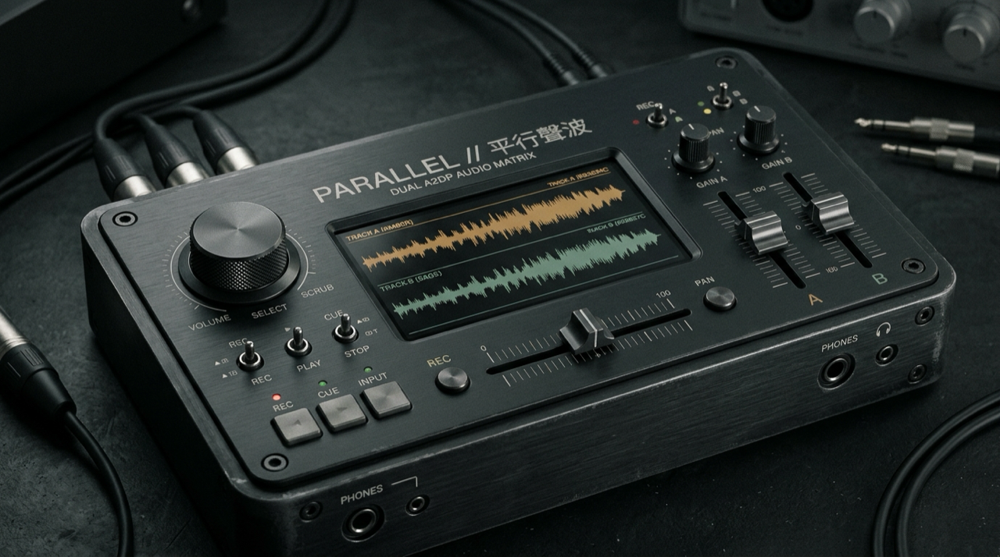
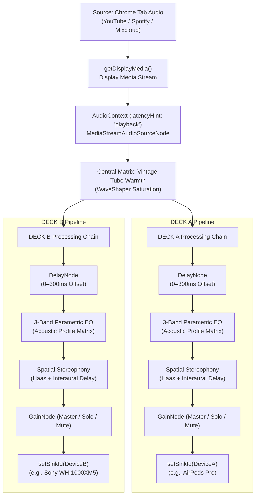

# ⟦ PARALLEL ⟧ // Parallel Soundwaves



<p align="center">
  <a href="./README.md">繁體中文</a> | <b>English</b> | <a href="./README.ja.md">日本語</a>
</p>

> **Two independent audio paths—bridging headphone latency to share the same world side by side.**
>
> An installation-free, zero-backend dual Bluetooth headphone audio router and sub-millisecond delay sync mixing console. Built on modern Web Audio standards, supporting **Traditional Chinese / English / Japanese** on macOS, Windows, and Linux.

◆ **Live Console (GitHub Pages): [https://lukas19990816.github.io/parallel/](https://lukas19990816.github.io/parallel/)**

---

## ⟦ 01 ⟧ Why PARALLEL Exists

On iOS / iPadOS, Apple's native "Audio Sharing" feature is strictly restricted to devices powered by Apple's proprietary H1 / H2 / W1 chips (AirPods and select Beats models). If either listener uses third-party wireless headphones (Sony, Soundcore, Bose, Sennheiser, etc.), simultaneous listening is unsupported.

On **macOS (Mac mini / MacBook / iMac)**, while the built-in "Audio MIDI Setup" utility allows creating a "Multi-Output Device," it introduces three critical bottlenecks:
1. **Cumbersome Configuration & Locked Volume Keys**: Once routed to a Multi-Output Device, the physical volume keys on macOS keyboards are locked and disabled; adjusting individual output levels requires navigating nested system dialogs.
2. **Inability to Compensate for Bluetooth Codec Delay Discrepancies (50ms–150ms)**: Built-in "Drift Correction" only aligns sample clocks. It **cannot apply millisecond-precision offset delays** between two headphones with disparate buffer depths (e.g., pairing a low-latency AirPods with a higher-latency Sony WH-1000XM5).
3. **Constant Window Switching**: Adjusting song choice, crossfading, or deck balances demands repeatedly interrupting work and navigating between tabs.

**`PARALLEL`** addresses these challenges directly via the browser's native **Web Audio API (`latencyHint: 'playback'`) + `HTMLMediaElement.setSinkId()` + `getDisplayMedia()`**. Using an expanded playback buffer to smooth out 2.4GHz RF packet jitter, it delivers dual-deck routing and sub-millisecond delay calibration in an open-source, zero-backend architecture.

---

## ⟦ 02 ⟧ Comparison with Existing Solutions

| Solution | Form Factor | Driver / App Required | Millisecond Delay Compensation (`0–300ms`) | Independent Gain + DJ Crossfader | Multilingual (ZH / EN / JA) | Platform Support |
| :--- | :--- | :---: | :---: | :---: | :---: | :--- |
| **PARALLEL (Web Console)** | **Pure Web App (Web Audio)** | ❌ **Zero Install** (Runs directly in browser) | ✅ **Supported** (`DelayNode` 1ms precision) | ✅ **Supported** (with `SOLO` / `MUTE` / `150%` headroom) | ✅ **ZH / EN / JA** | **macOS / Windows / Linux** (Chrome, Edge, Brave) |
| **macOS Built-in `Audio MIDI Setup`** | System Utility | ❌ Built-in | ❌ Unsupported (Clock drift correction only) | ⚠️ Buried UI; locks hardware volume keys | System default | macOS only |
| **[PairPods](https://github.com/wozniakpawel/PairPods)** / **[Tutti](https://github.com/BarryBarrywu/tutti)** | macOS Menu Bar App (Swift) | ⚠️ App Installation | ❌ Unsupported | ✅ Independent slider controls | English only | macOS only |
| **[BlackHole](https://github.com/ExistentialAudio/BlackHole)** / **[BackgroundMusic](https://github.com/kyleneideck/BackgroundMusic)** | HAL Audio Driver (C / C++) | ⚠️ Kernel driver install & reboot | ❌ Unsupported | ⚠️ Requires external DAW setup | English only | macOS only |

---

## ⟦ 03 ⟧ Operating System & Browser Compatibility

| Browser | Audio Routing (`setSinkId`) | Tab Capture (`getDisplayMedia`) | Minimum Recommended Version | Status |
| :--- | :---: | :---: | :---: | :--- |
| **Google Chrome** | ✅ Supported | ✅ Supported | Chrome 110+ | **Full Support (Recommended)** |
| **Microsoft Edge** | ✅ Supported | ✅ Supported | Edge 110+ | **Full Support** |
| **Brave Browser** | ✅ Supported | ✅ Supported | Current Release | **Full Support** |
| **Arc Browser** | ✅ Supported | ✅ Supported | Current Release | **Full Support** |
| **Apple Safari** | ❌ Missing `setSinkId` | ❌ Incompatible Audio Routing | Safari 17+ | **Unsupported** (Browser API omission) |
| **Mozilla Firefox** | ⚠️ Partial Flag Support | ❌ Incompatible Routing | Firefox 120+ | **Unsupported** |
| **iOS / iPadOS (Safari / Chrome)** | ❌ WebKit Audio Limitations | ❌ No Display Capture API | All versions | **Unsupported** |

---

## ⟦ 04 ⟧ Architecture & Design Principles



### Key Technical Characteristics
1. **Zero External Dependencies**: Pure vanilla JavaScript without npm packages, transpilers, or third-party tracking scripts.
2. **Buffer Management via `latencyHint: 'playback'`**: In wireless Bluetooth listening, millisecond interactive latency is unnecessary; what matters is clock stability. Using `'playback'` allocates larger internal Web Audio buffers, absorbing 2.4GHz RF frame drops and packet jitter.
3. **AirPlay / A2DP Multi-Output Dispatch**: Decouples output destinations via HTML5 Audio elements linked to Web Audio MediaStream destinations, routed independently through `HTMLMediaElement.setSinkId()`.
4. **Local Acoustic Profiles**: Compensates for typical closed-back headphone resonances (e.g., Sony 220Hz boxiness cut, Sennheiser Momentum 240Hz mid declutter, B&W 6.5kHz de-essing).

---

## ⟦ 05 ⟧ Step-by-Step Usage Guide

### Step 1: Connect Both Bluetooth Headphones
1. Open macOS **System Settings → Bluetooth**.
2. Pair and connect both headphones (e.g., AirPods Pro and Sony WH-1000XM5). Verify both show as "Connected" in the Bluetooth menu.

### Step 2: Open PARALLEL in Google Chrome
1. Navigate to [https://lukas19990816.github.io/parallel/](https://lukas19990816.github.io/parallel/).
2. Grant microphone/device enumeration permissions when prompted so Chrome can discover device IDs.

### Step 3: Assign Audio Sinks
* Under **DECK A**, select Headphone 1 from the dropdown.
* Under **DECK B**, select Headphone 2 from the dropdown.

### Step 4: Capture Audio Stream
1. Click **`START SHARING // 啟動分頁音訊擷取`**.
2. In the Chrome popup dialog, switch to the **"Chrome Tab"** tab (e.g., YouTube or Spotify).
3. Ensure the toggle **"Also share tab audio"** at the bottom left is checked.
4. Click **Share**.

### Step 5: Calibrate Sub-Millisecond Latency
* Put one earbud from Deck A into your left ear, and one earbud from Deck B into your right ear.
* Listen to rhythmic transients (percussion, speech, or tap sync click).
* Slowly slide the **DELAY (延遲補償)** slider on the faster headphone until the two transients align into a crisp, unified center image.

---

## ⟦ 06 ⟧ Limitations & Technical Boundaries

1. **DRM Protected Content (Netflix, Disney+, Apple TV+)**:
   Due to Widevine L1 / FairPlay DRM restrictions in Chromium browsers, capturing DRM-protected video tabs produces a black screen and muted audio. We recommend streaming with YouTube, YouTube Music, Spotify Web, SoundCloud, Bilibili, web radio, or directly playing local audio files.
2. **Browser Constraints (Safari & Firefox)**:
   Safari lacks `HTMLMediaElement.setSinkId()`, preventing multi-device routing. Firefox requires manual configuration in `about:config` (`media.setsinkid.enabled = true`), which is not recommended for non-technical users.
3. **Mobile Devices**:
   iOS and Android do not permit background display media tab capture; this tool is strictly designed for desktop environments.
4. **Bluetooth 2.4GHz Interference & Coexistence**:
   Connecting two high-bandwidth A2DP Bluetooth audio streams simultaneously can stress internal Bluetooth controllers, especially on older Mac mini models with antennas near bottom plates. For optimal stability, connect your computer to a 5GHz Wi-Fi network to avoid 2.4GHz spectrum congestion.

---

## ⟦ 07 ⟧ Quick Start

### Option A: Online Web Access (Recommended)
Simply open the hosted application via Google Chrome, Edge, or Brave:  
◆ **[https://lukas19990816.github.io/parallel/](https://lukas19990816.github.io/parallel/)**

### Option B: Local Execution
Because browser security policies require `setSinkId` and `getDisplayMedia` to operate within a secure context (`https://` or `http://localhost`), launch a lightweight local server:

```bash
# Clone repository
git clone https://github.com/Lukas19990816/parallel.git
cd parallel

# Serve with Python 3
python3 -m http.server 8080
# Open http://localhost:8080 in Chrome
```

---

## ⟦ 08 ⟧ Keyboard Shortcuts & Customization

The project uses clean, modular web standards (`index.html`, `css/app.css`, `js/app.js`, `js/i18n.js`, `js/headphone-profiles.js`) with CSS variables exposed under `:root`.

### ※ Mixing Console Shortcuts
* <kbd>Space</kbd>: Play / Pause / Trigger Tab Capture
* <kbd>1</kbd> / <kbd>2</kbd>: Deck A / Deck B Mute & Solo Toggle
* <kbd>S</kbd>: Resync & Flush Audio Buffers
* <kbd>M</kbd>: Auto-Tune Acoustic Profile Matrix
* <kbd>[</kbd> / <kbd>]</kbd>: Nudge Crossfader Left (Deck A) / Right (Deck B)
* <kbd>\</kbd>: Center Crossfader
* <kbd>↑</kbd> / <kbd>↓</kbd>: Master Volume Fine Adjustment (±5%)

---

## ⟦ 09 ⟧ Security & Privacy Design

1. **Zero External Backend**: Audio processing is executed 100% on the client CPU using native Web Audio primitives. No audio buffers or user telemetry are transmitted over the network.
2. **Hardened Content Security Policy (CSP)**:
   ```html
   <meta http-equiv="Content-Security-Policy" content="default-src 'self'; script-src 'self'; style-src 'self'; img-src 'self' data:; media-src 'self' blob:; connect-src 'none';">
   ```
   `connect-src 'none'` strictly blocks all outbound HTTP/WebSocket network calls, ensuring mathematical privacy.
3. **Zero Third-Party Code Dependencies**: Free of node_modules, advertising trackers, or external CDN scripts, mitigating supply chain vulnerabilities.

---

## ⟦ 10 ⟧ License

This project is licensed under the **[MIT License](./LICENSE)**.
