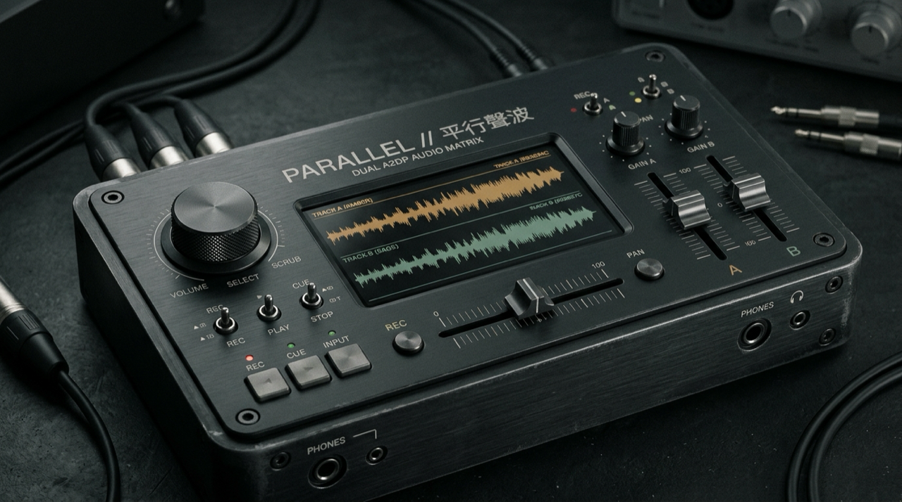
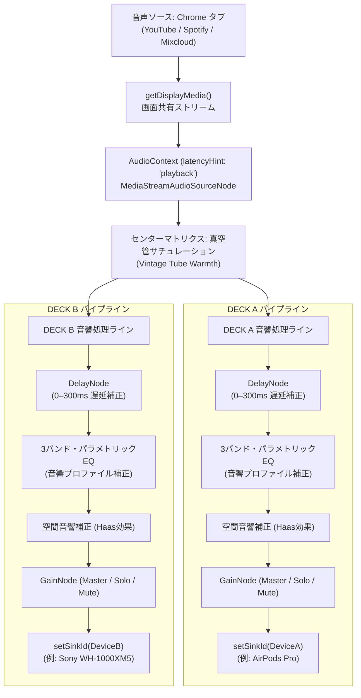

# ⟦ PARALLEL ⟧ // 平行音波



<p align="center">
  <a href="./README.md">繁體中文</a> | <a href="./README.en.md">English</a> | <b>日本語</b>
</p>

> **Two independent audio paths—bridging headphone latency to share the same world side by side.**
>
> **二つの独立した音響軌道が、ヘッドホンの時差を超えて同じ世界を共有する** —— インストール不要・単一の純粋なWeb技術で動作する、デュアルBluetoothヘッドホン音響ルーティング＆ミリ秒単位遅延同期ミキシングコンソール（**繁體中文 / English / 日本語** 対応。macOS / Windows / Linux 対応）。

◆ **Live Console (GitHub Pages): [https://lukas19990816.github.io/parallel/](https://lukas19990816.github.io/parallel/)**

---

## ⟦ 01 ⟧ 開発の背景と目的 (Why PARALLEL Exists)

iOS / iPadOS の標準機能である「オーディオ共有（Audio Sharing）」は、Apple独自の H1 / H2 / W1 チップを搭載した AirPods または Beats シリーズにのみ制限されています。どちらか一方が Sony、Soundcore、Bose、Sennheiser などのサードパーティ製ヘッドホンを使用している場合、同時に音楽を聴くことはできません。

また、**macOS（Mac mini / MacBook / iMac）** では、標準の「Audio MIDI 設定」から「複数出力装置（Multi-Output Device）」を作成可能ですが、実運用上 3 つの課題が存在します：
1. **設定が煩雑でキーボード音量調整が無効化される**：複数出力装置に切り替えると、Mac キーボードの物理音量キーがロックされ、ヘッドホンごとの音量微調整には深い階層のユーティリティを開く必要があります。
2. **メーカーごとの Bluetooth コーデック遅延差（50ms〜150ms）を補正できない**：macOS の「ドリフト補正」はサンプリングクロックの同期のみを行い、**処理速度の異なる2台のヘッドホン（例：低遅延の AirPods とバッファの深い Sony WH-1000XM5）間のミリ秒単位の遅延オフセットを手動調整できません**。
3. **曲の切り替えや音量調整のたびに作業ウィンドウの中断が発生する**。

**`PARALLEL`** は、ブラウザ標準の **Web Audio API (`latencyHint: 'playback'`) + `HTMLMediaElement.setSinkId()` + `getDisplayMedia()`** を活用（`playback` 設定によりバッファを拡大し、2.4GHz 帯のパケット揺らぎを吸収して音飛びを防止）。外部依存のない純粋なフロントエンド構成で、ミリ秒単位の遅延補正と独立ルーティングを実現します。

---

## ⟦ 02 ⟧ 既存のソリューションとの比較

| 方式 / プロジェクト | 形態 | ドライバ / アプリ導入 | ミリ秒単位の遅延補正 (`0–300ms`) | 独立音量調整 + クロスフェーダー | 多言語対応 (繁中 / 英語 / 日本語) | プラットフォーム |
| :--- | :--- | :---: | :---: | :---: | :---: | :--- |
| **PARALLEL (Web版)** | **Web アプリ (Web Audio)** | ❌ **不要** (ブラウザで即座に動作) | ✅ **対応** (`DelayNode` 1ms 単位調整) | ✅ **対応** (`SOLO` / `MUTE` / `150%` ゲイン) | ✅ **繁中 / EN / 日本語** | **macOS / Windows / Linux** (Chrome, Edge, Brave) |
| **macOS 標準 `Audio MIDI 設定`** | システム内蔵ツール | ❌ 不要 | ❌ 非対応 (クロック同期のみ) | ⚠️ UIが煩雑、物理音量キー無効化 | システム準拠 | macOS のみ |
| **[PairPods](https://github.com/wozniakpawel/PairPods)** / **[Tutti](https://github.com/BarryBarrywu/tutti)** | メニューバーアプリ (Swift) | ⚠️ アプリ導入 | ❌ 非対応 | ✅ 独立スライダー対応 | 英語のみ | macOS のみ |
| **[BlackHole](https://github.com/ExistentialAudio/BlackHole)** / **[BackgroundMusic](https://github.com/kyleneideck/BackgroundMusic)** | HAL ドライバ (C / C++) | ⚠️ ドライバ導入・再起動が必要 | ❌ 非対応 | ⚠️ DAW 等の外部設定が必要 | 英語のみ | macOS のみ |

---

## ⟦ 03 ⟧ 対応ブラウザおよび動作環境

| ブラウザ | 音声個別ルーティング (`setSinkId`) | タブ音声キャプチャ (`getDisplayMedia`) | 推奨バージョン | 動作状況 |
| :--- | :---: | :---: | :---: | :--- |
| **Google Chrome** | ✅ 対応 | ✅ 対応 | Chrome 110+ | **完全対応（推奨）** |
| **Microsoft Edge** | ✅ 対応 | ✅ 対応 | Edge 110+ | **完全対応** |
| **Brave Browser** | ✅ 対応 | ✅ 対応 | 最新版 | **完全対応** |
| **Arc Browser** | ✅ 対応 | ✅ 対応 | 最新版 | **完全対応** |
| **Apple Safari** | ❌ `setSinkId` 非搭載 | ❌ 音声ルーティング不可 | Safari 17+ | **非対応** (ブラウザ仕様上の制約) |
| **Mozilla Firefox** | ⚠️ 設定フラグ手動有効化が必要 | ❌ ルーティング非互換 | Firefox 120+ | **非対応** |
| **iOS / iPadOS (Safari / Chrome)** | ❌ WebKit 制限 | ❌ 画面共有音声取得不可 | 全バージョン | **非対応** |

---

## ⟦ 04 ⟧ システム構成と技術仕様



### 技術的な特徴
1. **外部依存パッケージ完全ゼロ**：npm パッケージやトランスパイラ、トラッキングスクリプトを一切使用しない純粋な Vanilla JavaScript 構成。
2. **`latencyHint: 'playback'` による安定化**：長時間のリスニングでは過度な低遅延よりも接続の安定性が重要です。バッファを広めに確保することで、Bluetooth 2.4GHz 帯特有のフレーム欠落やジッターを確実に吸収します。
3. **独立した音響補正マトリクス**：密閉型ヘッドホンの固有共振を打ち消す専用プロファイルを搭載（Sony 220Hz 箱鳴り抑制、Sennheiser Momentum 240Hz 濁り解消、B&W 6.5kHz 歯擦音抑制など）。

---

## ⟦ 05 ⟧ 利用手順ガイド

### ステップ 1: 2台の Bluetooth ヘッドホンを接続
1. macOS の **「システム設定」→「Bluetooth」** を開きます。
2. 2台のヘッドホンをペアリングし、両方が「接続済み」になっていることを確認します。

### ステップ 2: Google Chrome で PARALLEL を開く
1. [https://lukas19990816.github.io/parallel/](https://lukas19990816.github.io/parallel/) にアクセスします。
2. 初回起動時のマイク／デバイス一覧アクセス権限ダイアログで「許可」を選択します（デバイスIDの列挙に必要です）。

### ステップ 3: 各デッキにヘッドホンを割り当て
* **DECK A** のドロップダウンから 1台目のヘッドホンを選択します。
* **DECK B** のドロップダウンから 2台目のヘッドホンを選択します。

### ステップ 4: タブ音声の共有を開始
1. **`START SHARING // 啟動分頁音訊擷取`** をクリックします。
2. Chrome の共有確認ウィンドウで **「Chrome タブ」** タブ（YouTube や Spotify など）を選択します。
3. 左下の **「タブの音声も共有」** にチェックが入っていることを確認します。
4. **「共有」** をクリックします。

### ステップ 5: 遅延補正の調整
* 片耳ずつそれぞれのヘッドホンを装着し、リズムの明確な音（ドラムや音声、対時クリック音など）を再生します。
* 遅延の進んでいる側のデッキの **DELAY（遅延補正）** スライダーを徐々に上げ、両耳の音が完全に一致して中央に定位する位置に合わせます。

---

## ⟦ 06 ⟧ 技術的な制約事項

1. **DRM 保護コンテンツ（Netflix、Disney+、Apple TV+ 等）**:
   Chromium の Widevine L1 / FairPlay 保護により、DRM で保護された動画タブを画面共有でキャプチャすると映像が黒画面になり音声がミュートされます。YouTube、Spotify Web、SoundCloud、Bilibili、またはローカル音源ファイルのご利用を推奨します。
2. **Safari および Firefox の非対応**:
   Safari は `HTMLMediaElement.setSinkId()` を実装していません。Firefox では `about:config` での特殊フラグ設定が必要となるため、非推奨としています。
3. **モバイルブラウザ（iOS / Android）**:
   モバイル OS のサンドボックス制約上、バックグラウンドでの画面共有・音声抽出がサポートされていないため動作しません。
4. **Bluetooth 2.4GHz 帯の電波干渉**:
   同時に2系統の高音質 A2DP ストリームを送信するため、Mac mini などの一部モデルでは USB 3.0 ハブや 2.4GHz Wi-Fi との電波干渉が発生する場合があります。安定した再生のために 5GHz Wi-Fi への接続を推奨します。

---

## ⟦ 07 ⟧ クイックスタート

### 方法 A: オンライン版の利用（推奨）
Google Chrome、Edge、または Brave から以下の URL にアクセスしてください：  
◆ **[https://lukas19990816.github.io/parallel/](https://lukas19990816.github.io/parallel/)**

### 方法 B: ローカル環境での起動
ブラウザのセキュリティ仕様により、`setSinkId` および `getDisplayMedia` は HTTPS または `http://localhost` 環境下でのみ動作します：

```bash
# リポジトリのクローン
git clone https://github.com/Lukas19990816/parallel.git
cd parallel

# Python 3 ローカルサーバーの起動
python3 -m http.server 8080
# Chrome で http://localhost:8080 を開く
```

---

## ⟦ 08 ⟧ ショートカットキーとカスタマイズ

本プロジェクトは標準的な Web 技術（`index.html`、`css/app.css`、`js/app.js`、`js/i18n.js`、`js/headphone-profiles.js`）でモジュール分割されており、`:root` 内の CSS 変数から自由に外観を変更可能です。

### ※ コンソール操作用キーボードショートカット
* <kbd>Space</kbd>: 再生／一時停止／タブ共有の開始
* <kbd>1</kbd> / <kbd>2</kbd>: Deck A / Deck B のミュート＆ソロ切り替え
* <kbd>S</kbd>: 音声バッファのリセットおよび再同期
* <kbd>M</kbd>: 自動音響補正マトリクス（Auto-Tune）の実行
* <kbd>[</kbd> / <kbd>]</kbd>: クロスフェーダーを左（Deck A）／右（Deck B）へ微動
* <kbd>\</kbd>: クロスフェーダーを中心位置に復帰
* <kbd>↑</kbd> / <kbd>↓</kbd>: マスター音量の微調整（±5%）

---

## ⟦ 09 ⟧ セキュリティとプライバシー設計

1. **外部通信ゼロの完全ローカル処理**：音声信号処理は 100% 端末の CPU 上で実行され、外部サーバーへの通信やデータ収集は一切行いません。
2. **堅牢な CSP（Content Security Policy）設定**：
   ```html
   <meta http-equiv="Content-Security-Policy" content="default-src 'self'; script-src 'self'; style-src 'self'; img-src 'self' data:; media-src 'self' blob:; connect-src 'none';">
   ```
   `connect-src 'none'` により、外部への不正なネットワーク送信をブラウザ層で完全に遮断しています。
3. **サプライチェーン攻撃への防御**：外部 npm パッケージや CDN 依存を完全に排除しています。

---

## ⟦ 10 ⟧ ライセンス

本プロジェクトは **[MIT License](./LICENSE)** の下で公開されています。
