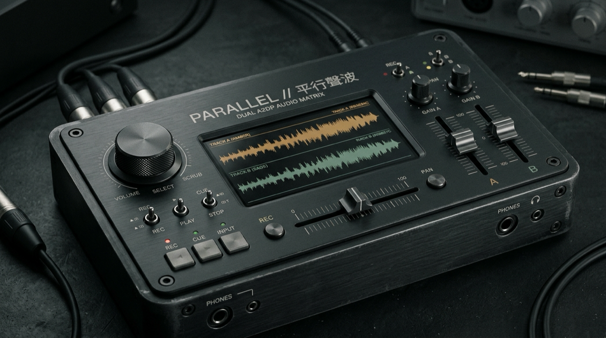

# ⟦ PARALLEL ⟧ // 平行聲波



<p align="center">
  <b>繁體中文</b> | <a href="./README.en.md">English</a> | <a href="./README.ja.md">日本語</a>
</p>

> **Two independent audio paths—bridging headphone latency to share the same world side by side.**
>
> **兩條獨立的平行音軌，跨越耳機時差、並肩聽見同一個世界** —— 免安裝、單一 HTML 檔案的雙藍牙耳機音訊分流與毫秒級延遲同步混音台（支援 **繁體中文 / English / 日本語** 三語切換，適用於 macOS、Windows 與 Linux）。

◆ **Live Console (GitHub Pages)：[https://lukas19990816.github.io/parallel/](https://lukas19990816.github.io/parallel/)**

---

## ⟦ 01 ⟧ 為什麼要做這個專案？ (Why PARALLEL Exists)

在 iPhone / iPad 上，Apple 原生的「共享音訊（Audio Sharing）」**只限定配備自家 H1 / H2 / W1 晶片的 AirPods 或 Beats 耳機**；只要其中一人戴的是 Sony、Soundcore、Bose、Sennheiser 等第三方藍牙耳機，就無法一起聽歌。

而在 **macOS（Mac mini / MacBook / iMac）** 上，雖然系統內建了「音訊 MIDI 設定（Audio MIDI Setup）」可以建立「多重輸出裝置（Multi-Output Device）」，但實際操作有三大痛點：
1. **設定繁瑣且鎖死音量鍵**：一旦切換至多重輸出裝置，Mac 鍵盤上的實體音量鍵就會完全失效，調整兩隻耳機的獨立音量必須層層點開系統工具。
2. **無法補償不同廠牌耳機的「藍牙解碼時間差（50ms–150ms）」**：macOS 內建的「漂移修正（Drift Correction）」只能對齊取樣時脈（Sample Clock），**無法針對快慢不同的兩隻耳機（例如延遲較低的 AirPods 搭配延遲較高的 Sony XM5）手動加入毫秒級延遲補償（Delay Offset）**。
3. **點歌與調整音量需要不斷切換視窗**。

**`PARALLEL // 平行聲波`** 透過瀏覽器原生的 **Web Audio API (`latencyHint: 'playback'`) + `HTMLMediaElement.setSinkId()` + `getDisplayMedia()`**（採用 `playback` 原生排程以較大緩衝平滑吸收藍牙 2.4GHz 無線封包抖動，確保長效聆聽不爆音），用開源純前端架構建構出雙軌平行混音與毫秒級延遲補償控制台，一次解決上述所有問題。

---

## ⟦ 02 ⟧ 與現有開源專案 / 解決方案比較 (Comparison with Existing Solutions)

| 方案 / 專案 | 類型 | 是否需安裝驅動 / App | 跨廠牌毫秒級延遲補償 (`0–300ms` Delay) | 獨立音量 + DJ Crossfader | 多語系 (繁/英/日) | 跨平台支援 |
| :--- | :--- | :---: | :---: | :---: | :---: | :--- |
| **PARALLEL (本開源網頁版)** | **單一 HTML 網頁 (Web Audio)** | ❌ **完全免安裝** (打開瀏覽器即用) | ✅ **支援** (`DelayNode` 1ms 精度微調) | ✅ **支援** (含 `SOLO` / `MUTE` / `150%` 增益) | ✅ **繁中 / EN / 日本語** | **macOS / Windows / Linux** (Chrome / Edge / Brave) |
| **macOS 內建 `音訊 MIDI 設定`** | 系統內建工具 | ❌ 免安裝 | ❌ 不支援 (僅支援時脈漂移修正) | ⚠️ 介面藏在深處，且會鎖死鍵盤音量鍵 | 依系統 | 僅 macOS |
| **[PairPods](https://github.com/wozniakpawel/PairPods)** / **[Tutti](https://github.com/BarryBarrywu/tutti)** | 原生 macOS Menu Bar App (Swift) | ⚠️ 需安裝 App / Homebrew Cask | ❌ 不支援手動毫秒級延遲推桿 | ✅ 支援選單列獨立音量 | 僅英文 | 僅 macOS |
| **[BlackHole](https://github.com/ExistentialAudio/BlackHole)** / **[BackgroundMusic](https://github.com/kyleneideck/BackgroundMusic)** | macOS 虛擬音效卡驅動 (HAL Driver) | ⚠️ 需安裝核心音訊驅動並重開機 | ❌ 不支援 | ⚠️ 需搭配 DAW 或額外設定 | 僅英文 | 僅 macOS |

---

## ⟦ 03 ⟧ 支援的作業系統與瀏覽器 (Supported Systems & Browsers)

### 1. 作業系統 (Operating Systems)
* **主要設計目標：macOS**（Mac mini、MacBook Air、MacBook Pro、iMac、Mac Studio）。
* **相容桌面系統：Windows 10 / 11、Linux**（只要作業系統支援同時連接兩隻藍牙音訊輸出裝置，或「1 隻藍牙耳機 + 1 隻有線耳機」皆可運作）。
* ❌ **不支援 iOS / iPadOS / Android 手機瀏覽器**：由於行動作業系統底層（如 iOS `AVAudioSession`）硬體鎖死同時只能啟用單一標準藍牙 A2DP 路由，且行動版瀏覽器不支援 `getDisplayMedia` 分頁音訊擷取與 `setSinkId` 多重輸出。

### 2. 瀏覽器需求與各家內核限制 (Browser Requirements & Engine Matrix)

| 瀏覽器核心 | 代表瀏覽器 | 支援多硬體分流 (`setSinkId`) | 支援單一分頁音訊擷取 (`Tab Audio Loopback`) | 支援狀態 |
| :--- | :--- | :---: | :---: | :---: |
| **Blink (Chromium)** | **Google Chrome、Microsoft Edge、Brave、Arc、Vivaldi** | ✅ **完整支援** (原生穩定) | ✅ **完整支援** (可單獨擷取分頁並靜音) | 🟢 **完全相容 (最推薦)** |
| **WebKit** | **Apple Safari** (macOS / iOS) | ❌ **不支援** (`setSinkId` 屬性未實作) | ❌ **不支援** (無法單獨抽離分頁音訊) | 🔴 **無法運作** |
| **Gecko** | **Mozilla Firefox** | ⚠️ **預設關閉** (需進 `about:config` 開啟) | ❌ **不支援** (螢幕分享不支援 Tab Audio) | 🔴 **無法分頁串流** |

> **※ 為什麼 Safari 與 Firefox 無法運作？**
> 1. **Apple Safari (WebKit)**：Apple 至今未在 WebKit 實作 `HTMLMediaElement.setSinkId()`，所有音訊強制輸出至系統預設端點，無法做到雙耳機硬體分流；此外商業策略上 Apple 將「音訊共享」作為其專屬 H1/H2 晶片（AirPods/Beats）的生態護城河。
> 2. **Mozilla Firefox (Gecko)**：基於防範瀏覽器指紋追蹤（Anti-Fingerprinting）的隱私考量，Firefox 將音訊輸出端點 API 預設鎖定；且其 `getDisplayMedia` 尚未實作 Chromium 的單一分頁純音訊循環迴路。
> 3. **結論**：請務必使用 **Google Chrome、Edge、Brave 或 Arc** 等 Chromium 核心瀏覽器開啟本專案。

---

## ⟦ 04 ⟧ 重要技術限制與串流平台 DRM 邊界說明 (Technical Limitations & DRM Boundaries)

使用本開源網頁版前，請詳閱以下關於串流版權（DRM）與硬體邊界的技術說明：

### 1. 為什麼網頁版無法支援 Netflix / Disney+ / Apple TV+？（硬體級 DRM 防拷機制）

* **瀏覽器硬體防拷管線（Widevine L1/L3 & Apple FairPlay DRM）**：
  主流影視串流平台（包括 **Netflix、Disney+、Apple TV+、Amazon Prime Video** 等）均啟用了硬體級別的數位版權管理（DRM）。當受保護的視訊串流在 Chrome / Edge 中解碼播放時，系統會建立一條加密的硬體渲染通道（Protected Media Path / HDCP）。
* **分頁擷取 API (`getDisplayMedia`) 的物理阻斷**：
  網頁版的雙耳機分流依賴 Chromium 提供的 `navigator.mediaDevices.getDisplayMedia({ audio: true })` 進行純音訊循環迴路（Loopback）。然而，當瀏覽器檢測到使用者試圖擷取包含 DRM 授權內容的分頁時，底層的硬體解密管線（Hardware Decryption Engine）會**立即強制中斷視訊訊號傳輸，回傳全黑畫面**，或直接拋出解密阻斷錯誤（例如 Netflix 著名的 **`Error M7361-1253`**）。
* **無法繞過的安全沙盒**：
  這是作業系統核心與安全晶片（Apple T2 / Apple Silicon Secure Enclave / Intel SGX / AMD PSP）在物理層級實施的防側錄保護。**任何運行在標準瀏覽器沙盒內的純前端網頁，技術上 100% 無法突破此防拷限制**。
* **推薦使用情境**：
  強烈推薦搭配 **YouTube、YouTube Music、Spotify 網頁版、SoundCloud、Bilibili、線上廣播電台**，或直接將本地無損音樂檔（MP3 / FLAC / WAV）載入控制台，即可享有最極致順暢的雙耳機同步聆聽體驗！

---

## ⟦ 05 ⟧ 適用場景 (Use Cases)

1. **情侶 / 室友 / 朋友在電腦前共用兩隻不同廠牌耳機聽歌或追劇**：
   * 一人戴 Sony、一人戴 AirPods / Soundcore / Bose，一起聽 **YouTube Music、Spotify 網頁版、YouTube、Bilibili** 或本地無損音檔，各自調整最舒適的音量。
   * ※ 請注意：**Netflix、Disney+、Apple TV+** 等受硬體 DRM 保護的串流平台，受限於瀏覽器防拷機制會阻擋分頁音訊擷取。
2. **深夜宿舍 / 圖書館 / 辦公室靜音共享**：
   * 不能開喇叭外放時，直接將電腦音訊分流給兩副耳機並各自控制音量。
3. **「1 隻有線耳機 + 1 隻藍牙耳機」零時間差同步**：
   * 有線耳機幾乎是 `0ms` 延遲，而藍牙耳機約有 `100ms–200ms` 延遲。透過本工具將有線耳機那一軌的 **`SYNC DELAY`** 往右拉到約 `120ms–180ms`，兩人聽到的節拍就能完美重疊！
4. **本地無損音樂檔（MP3 / FLAC / WAV / M4A）雙耳機直推監聽**：
   * 使用內建的 `載入本地音訊檔` 功能，完全不需開啟分頁共享即可直接雙耳機同步播放（且電腦內建喇叭完全靜音不漏音）。

---

## ⟦ 06 ⟧ 為什麼兩隻藍牙耳機有時會「一起延遲（Lag）」？怎麼看藍牙訊號強度？ (Bluetooth Latency & Diagnostics)

在 macOS 上同時連接兩隻非 Apple 藍牙耳機時，若偶爾遇到**兩邊一起頓一下或產生延遲**，這涉及藍牙底層物理機制與音訊緩衝設計：

### 1. 為什麼一隻耳機受干擾時，會讓「兩邊一起 Lag」？
* **單一藍牙天線分時多工（TDM）與 ARQ 重傳阻塞**：
  電腦內部通常只有**一顆藍牙晶片與一組 `2.4GHz` 射頻天線**，必須以毫秒級輪流發送封包給耳機 A 與耳機 B。藍牙 A2DP 底層的 L2CAP 協定具有**自動重傳機制（ARQ）**：當其中一隻耳機（例如距離較遠或被身體遮擋的耳機 A）掉封包時，系統藍牙控制器會**暫停發送新封包，優先重傳給耳機 A**。在這幾十毫秒的重傳等待期間，**排在同一個硬體佇列後面的耳機 B 封包也會被一起卡住（Head-of-Line Blocking）**，接著作業系統音訊核心（macOS `coreaudiod` / Windows `WASAPI`）為了防破音會同時拉大安全緩衝區，造成兩邊一起慢半拍。

### 2. 抗干擾緩衝架構設計：原生深水池 (Deep Reservoir Architecture)
在雙人專注工作、自習或閱讀的共享音樂場景中，使用者對 200~300ms 的絕對播放延遲通常不敏感，但對音訊卡頓、掉訊或單邊干擾引發的連鎖中斷要求較高。

為兼顧雙藍牙鏈結的傳輸穩定性，`PARALLEL` 採用單一預載緩衝架構（Deep-Reservoir Buffer Engine）：

```
                    ┌──────────────────────────────────────────────┐
                    │     Chrome Tab Audio Stream / Local File     │
                    └──────────────────────┬───────────────────────┘
                                           │
                                           ▼
                     ┌───────────────────────────────────────────┐
                     │   W3C AudioContext (latencyHint: playback)│
                     │   [核心配置：要求作業系統提供最高優先權排程]        │
                     └─────────────────────┬─────────────────────┘
                                           │
                                           ▼
                     ┌───────────────────────────────────────────┐
                     │   Central Deep-Reservoir Node (250ms)     │
                     │   [抗 2.4GHz 突發重傳與多工抖動的中央蓄水池]    │
                     └─────────────────────┬─────────────────────┘
                                           │
                                           ▼
                     ┌───────────────────────────────────────────┐
                     │   Acoustic Matrix Enhancer (可即時 A/B 開關)│
                     │   ├─ TUBE (類比真空管偶次諧波增強)           │
                     │   ├─ SURROUND (3D 空間外擴 / Bauer 互饋雙模) │
                     │   └─ ROOM AIR (3D 劇院巨幕 / 錄音室空間微環境) │
                     └──────┬─────────────────────────────┬──────┘
                            │                             │
                            ▼                             ▼
                 ┌────────────────────┐        ┌────────────────────┐
                 │ Deck A Profile EQ  │        │ Deck B Profile EQ  │
                 │(AirPods/Pro/Anker) │        │(AirPods/Pro/Anker) │
                 └──────────┬─────────┘        └──────────┬─────────┘
                            │                             │
                            ▼                             ▼
                 ┌────────────────────┐        ┌────────────────────┐
                 │ Deck A Sync Delay  │        │ Deck B Sync Delay  │
                 │   (0 ~ 300 ms)     │        │   (0 ~ 300 ms)     │
                 └──────────┬─────────┘        └──────────┬─────────┘
                            │                             │
                            ▼                             ▼
                 ┌────────────────────┐        ┌────────────────────┐
                 │  Gain Node A (Vol) │        │  Gain Node B (Vol) │
                 └──────────┬─────────┘        └──────────┬─────────┘
                            │                             │
                            ▼                             ▼
                 ┌────────────────────┐        ┌────────────────────┐
                 │ Headphone A Sink   │        │ Headphone B Sink   │
                 └────────────────────┘        └────────────────────┘
```

1. **W3C `latencyHint: 'playback'` 原生排程優化**：
   直接通知瀏覽器與作業系統音訊核心：「此串流為高品質背景音樂播放，請分配充足的 Ring Buffer 與音訊執行緒時間片」，防止分頁在背景執行時被 Chromium 節流（Throttling）。
2. **250ms 中央深水池（Deep Reservoir）**：
   在上游分流前建立 250ms 彈性緩衝池，給底層藍牙晶片充分的存糧儲備。當周圍有短暫 Wi-Fi 干擾或單邊耳機觸發 L2CAP 3~5 次突發重傳時，耳機端持續消化儲備，**完全不破音、不掉字、雙邊不連鎖卡頓**。
3. **聲學聽感矩陣（Acoustic Matrix Enhancer，中央控制台具備即時 A/B 開關、0~100% 精準推桿與演算法切換）**：
   * **`TUBE`（類比真空管偶次諧波染色，0~100% 可調 Drive）**：採用 $C^\infty$ 平滑單調非對稱雙曲正切飽和函數（Asymmetric $\tanh$ Curve），於正負半週注入精準二次偶次諧波（2nd Harmonics），並自動將最大峰值壓制在 0.95 以內（防數位削波過載防線）。徹底消除封閉式耳機（如 Soundcore Space One）高頻的毛刺刺耳感，使人聲豐潤溫暖，絕不破音。
   * **`SURROUND`（3D 空間立體環繞聲場外擴 / 可切換 XF 互饋監聽）**：
     * **`3D WIDE 模式`（預設，突破耳機邊界）**：採用 Mid/Side（中/側聲道）動態分解矩陣，在保證中央人聲與重低音（Mid）無損居中的前提下，將空間氛圍與立體聲殘響（Side）放大至 1.0x ~ 2.8x，並注入 $>6.5\text{kHz}$ 的空氣微仰角濾波，將狹窄的耳機內音場硬生生往外推開 2~3 公尺，形成 360 度立體環繞氣場！
     * **`XF 互饋模式`（點擊切換）**：切換為經典 Bauer 雙耳交叉反饋，將左右隔離度收斂為前方 60 度揚聲器聽感，消除老歌硬切雙聲道的聽覺疲勞。
   * **`ROOM AIR`（3D 空間微環境，可切換 CINEMA 巨幕 / STUDIO 錄音室）**：
     * **`CINEMA 劇院模式`（預設）**：載入 480ms 算法合成之巨幕電影院／音樂廳脈衝響應（包含 10 道交錯的 Haas 早期反射與空氣吸音擴散），濕聲最高可推至 65%，徹底粉碎封閉式降噪耳機的「真空抽離感」，營造如置身 IMAX 劇院的包覆式環繞。
     * **`STUDIO 錄音室模式`**：切換為 240ms 精準緊湊的專業監聽室微環境。
4. **耳機型號底層特徵識別與獨立雙軌校正（Per-Deck Acoustic Fingerprinting & Profiling）**：
   * **底層偵測原理**：透過 W3C `navigator.mediaDevices.enumerateDevices()` 取得藍牙底層廣播之設備特徵，精準識別耳機型號，並在 DECK A 與 DECK B 的獨立音訊管道掛載專屬的三段式 32-bit Float 補償濾波鏈（BiquadFilter）：
     * **`AirPods Pro (1/2)`（入耳密閉型）**：矽膠耳塞物理封死耳道造成「耳壓感」與「高頻冷冽偏乾」。專屬方案注入 `+3.2dB @ 9kHz` Air Band 超高頻空氣感，並以 `-1.2dB @ 150Hz` 收束過肥的入耳低頻，徹底釋放入耳式耳壓，重現立體開揚聽感！
     * **`AirPods (1/2/3)`（半入耳開放型）**：天生無耳塞密封造成極端低頻漏音（80Hz 以下劇降）。專屬方案注入 `+4.5dB @ 110Hz` 低頻底層補償，並以 `-1.8dB @ 3.2kHz` 撫平塑膠外殼共振齒音，重現溫厚澎湃低音！
     * **`Soundcore Space One / Anker`（封閉耳罩型）**：封閉腔體在 6.8kHz 有明顯金屬刺耳峰值。專屬方案以 `-3.0dB @ 6.8kHz` 精準壓制毛刺，並收束肥厚中低頻。
     * **`Sony WH/WF-1000X`（暖厚旗艦型）**：調音厚實但高頻稍嫌暗沉。專屬方案注入 `+2.0dB @ 4.5kHz` 咬字清晰度與 `+3.0dB @ 8.5kHz` 高頻通透感，重現發燒級解析力。
   * **兩側雙軌完全獨立**：若一人戴 AirPods Pro、另一人戴普通 AirPods，系統會在兩副耳機上各自套用專屬補償，兩個人各自獲得最極致的聽感體驗！
   * **中央控制台 `[⚡ AUTO-OPTIMIZE]` 一鍵優化**：點擊即可根據當前兩副耳機的特徵，自動將中央矩陣（TUBE、SURROUND、ROOM AIR）推桿同步推升至黃金平衡點。
5. **切歌無爆音瞬間排空（Anti-Pop Atomic Flush）**：
   換歌或載入音訊時，自動執行 **15ms 微淡出 $\to$ 瞬時抽乾舊緩衝 $\to$ 重新蓄水 $\to$ 15ms 微淡入**。徹底消除因直流偏移（DC Offset）引發的耳機「啪（Pop）」雜音，切歌乾淨俐落。
6. **手動重置保障**：
   若因拔插裝置或環境極端干擾累積了系統緩衝，隨時點擊 **`[SYNC] 重置緩衝`** 即可在 `0.02 秒` 內瞬時校正並重啟深水池。

### 3. 如何查看連到的藍牙耳機「訊號強度（RSSI dBm）」？
* **為什麼網頁無法直接顯示藍牙 dBm？**：基於 Chrome 瀏覽器沙盒安全限制，網頁只能存取 CoreAudio 音訊路由層，無法讀取底層 `IOBluetooth` 無線電射頻強度（且 Web Bluetooth API 僅支援 BLE 低功耗感測器，不支援 A2DP 傳統音訊耳機）。
* **※ macOS 一鍵查看真實藍牙訊號強度（RSSI）秘訣**：
  1. 按住鍵盤上的 **`Option (⌥)` 鍵**，同時用滑鼠點擊 Mac 右上角選單列的 **「藍牙圖示」**（或在終端機輸入 `system_profiler SPBluetoothDataType | grep -E "Name|RSSI"`）。
  2. 你會看到每隻已連線耳機下方出現 **`RSSI`** 數值：
     * **`-40 ~ -60 dBm`**：訊號極佳，雙耳機串流非常穩定。
     * **`-65 ~ -75 dBm`**：訊號中度衰減，兩隻耳機同時連時容易觸發重傳與緩衝放大。
     * **`-80 dBm` 以下**：訊號微弱或受嚴重 `2.4GHz` 干擾，請靠近電腦或避開干擾源。

### 4. 頭號殺手：請關閉耳機的「一對二多點連線（Multipoint）」！
* 許多高階耳機（如 **Sony WH-1000XM5 / XM4**、**Bose QC Ultra**）支援同時連著手機與電腦。當耳機連著 Mac 進行雙耳機串流，**背景又同時連著手機時**，耳機晶片會不斷分心與手機輪詢，導致 Mac 端藍牙封包嚴重塞車。
* **[ 解法 ]**：雙耳機共享期間，**請先將手機藍牙關閉（或在手機上暫時斷開該耳機）**，讓耳機專心一對一連著 Mac，卡頓感會立刻消失 80% 以上。

### 5. AirPods 與第三方耳機混搭時的「先天解碼速度差」
* AirPods 在 macOS 上延遲通常比第三方主動降噪耳機（如 Sony XM5）快約 `80ms ~ 120ms`。
* **[ 解法 ]**：把**比較快的那隻耳機（例如 AirPods）的 `SYNC DELAY` 推桿往右調至 `80ms ~ 120ms`**（讓快的耳機等慢的耳機），兩個人聽到的節拍就會完全同步。

### 6. 音質突然變得像「講電話」一樣悶？（macOS 麥克風輸入陷阱）
* 如果 macOS 自動把其中一隻藍牙耳機選為「預設麥克風輸入（Input Device）」，該耳機會強制切換成「雙向通話模式（HFP，單聲道 `16kHz`）」，音質會嚴重劣化。
* **[ 解法 ]**：打開 Mac **「系統設定」➔「聲音」➔「輸入（Input）」**，將麥克風改選為 **Mac 內建麥克風** 或 **外接螢幕麥克風**，音質就會立刻恢復滿血雙聲道立體聲（`44.1kHz / 48kHz`）。

### 7. Mac mini 用戶特別注意：`2.4GHz` 干擾
* Mac mini 的藍牙天線位於機身底部圓蓋處，極易受到背後 USB-A 3.0 外接硬碟/Hub 以及 `2.4GHz` Wi-Fi 干擾。建議 Mac mini 用戶改連 **`5GHz` Wi-Fi**，並避免將未屏蔽的 USB 3.0 裝置緊貼機身底部。

---

## ⟦ 07 ⟧ 快速開始 (Quick Start)

### 方式 A：直接透過 GitHub Pages 線上開啟（0 安裝、最推薦！）
直接使用 **Google Chrome**（或 Edge / Brave / Arc）點開下方公開網址即可立即使用，**完全不需要安裝 Python 或啟動任何本地伺服器**（建議直接加入 Chrome 書籤）：

◆ **Live Console (GitHub Pages)：[https://lukas19990816.github.io/parallel/](https://lukas19990816.github.io/parallel/)**

### 方式 B：在本地端執行 (Local Execution)
由於 Chrome 的 `getDisplayMedia` 與 `setSinkId` 安全限制要求頁面必須在 `https://` 或 `http://localhost` 下執行（直接雙擊 `file://` 會被瀏覽器阻擋分頁擷取）：

1. **macOS 一鍵啟動**：
   直接雙擊專案內的 `launch-mac.command`（若首次執行遇到權限提示，可在終端機執行 `chmod +x launch-mac.command`）。
2. **或是使用一行指令啟動**：
   ```bash
   python3 -m http.server 8766 --bind 127.0.0.1
   ```
   接著使用 Google Chrome 打開 **`http://localhost:8766`**。

---

## ⟦ 08 ⟧ 歡迎 Fork 並用你的 AI Agent 客製化專屬混音台！(Vibe-Coding & AI Agent Friendly)

開源網頁版前端採用純粹、無打包工具相依的標準模組化結構（`index.html` + `css/app.css` + `js/`），所有主題變數整理於 `css/app.css` 開頭的 `:root`。

非常歡迎你 **Fork** 這個專案，直接把專案丟給你的 AI Coding Agent（例如 **Google Antigravity、Claude Code、Cursor、GitHub Copilot、Windsurf**），用自然語言改成你喜歡的硬體風格或擴充功能！

### ※ 實體混音台鍵盤快捷鍵 (Global Keyboard Shortcuts)
* <kbd>Space</kbd>：快速播放 / 暫停 / 啟動分頁音訊擷取
* <kbd>1</kbd> / <kbd>2</kbd>：DECK A / DECK B 靜音 / 監聽切換
* <kbd>S</kbd>：重置並排空音訊緩衝區（Resync Buffer）
* <kbd>M</kbd>：一鍵智慧優化聲學聽感矩陣（Auto-Tune Matrix）
* <kbd>[</kbd> / <kbd>]</kbd>：Crossfader 交叉推桿向左（Deck A）/ 向右（Deck B）微調
* <kbd>\</kbd>：Crossfader 快速歸零置中
* <kbd>↑</kbd> / <kbd>↓</kbd>：Master 總音量微調（±5%）

### ※ 可以直接複製給 AI Agent 的 Prompt 範例：
* **工業風白色合成器（Teenage Engineering OP-1 風格）**：
  > *"請幫我修改 `css/app.css` 的 `:root` CSS 變數與樣式，把這台混音台改成 Teenage Engineering OP-1 的淺灰白工業設計風格，搭配橘色（`#ff5500`）與藍色（`#0066ff`）實體旋鈕推桿點綴。"*
* **80 年代復古 Synthwave / Cyberpunk 霓虹風**：
  > *"請幫我把 `css/app.css` 改成 80 年代復古 Synthwave 風格，使用深紫黑背景、霓虹洋紅（Deck A）與電光青（Deck B）配色，並幫頻譜儀加上漸層發光效果。"*
* **新增 3 段式 EQ 等化器（Low / Mid / High）**：
  > *"請在 `js/app.js` 的 Web Audio 圖（`buildLowLatencyGraph`）中，幫 Deck A 跟 Deck B 各自加上 `BiquadFilterNode` 的 BASS / TREBLE 旋鈕或推桿！"*

---

## ⟦ 09 ⟧ 安全性與隱私設計 (Security & Privacy Design)

為保障使用者裝置與隱私安全，本專案在架構上落實以下安全實踐：

* **純前端本機運作（100% Local In-Browser）**：所有音訊分流與 DSP 運算皆在瀏覽器內部完成，音訊資料不經過任何後端伺服器。
* **零外部依賴套件（0 External Dependencies）**：不引用第三方 JavaScript 框架或外部 CDN 腳本，降低第三方軟體供應鏈風險。
* **靜態內嵌圖示**：所有介面圖示皆以 SVG 座標形式直接內嵌於 HTML 檔案中，避免額外發起未知的外部網路資源請求。
* **嚴格的內容安全策略（Content-Security-Policy）**：於 HTML 標頭宣告 `connect-src 'none'; object-src 'none'; form-action 'none'`，限制頁面發送非預期的外部連線。
* **安全 DOM 渲染**：針對作業系統回傳的藍牙裝置名稱，一律採用 `replaceChildren()`、`new Option()` 與 `textContent` 進行轉譯渲染，避免使用 `innerHTML` 以降低 DOM-based XSS 風險。

---

## ⟦ 10 ⟧ 授權條款 (License)

本專案採用 **[MIT License](./LICENSE)** 開源授權，歡迎自由使用、修改、Fork 與分享！
